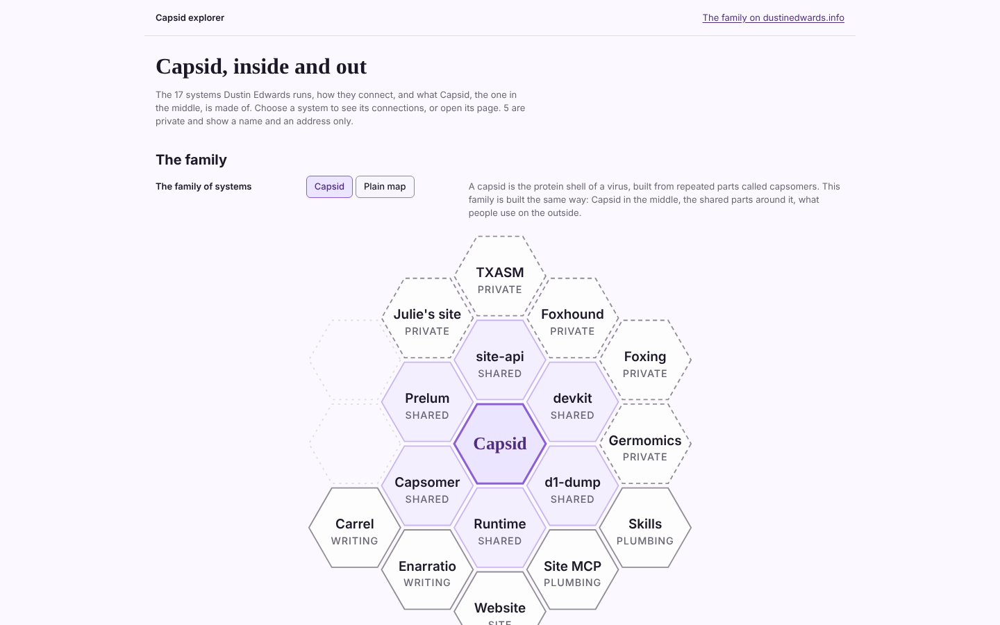
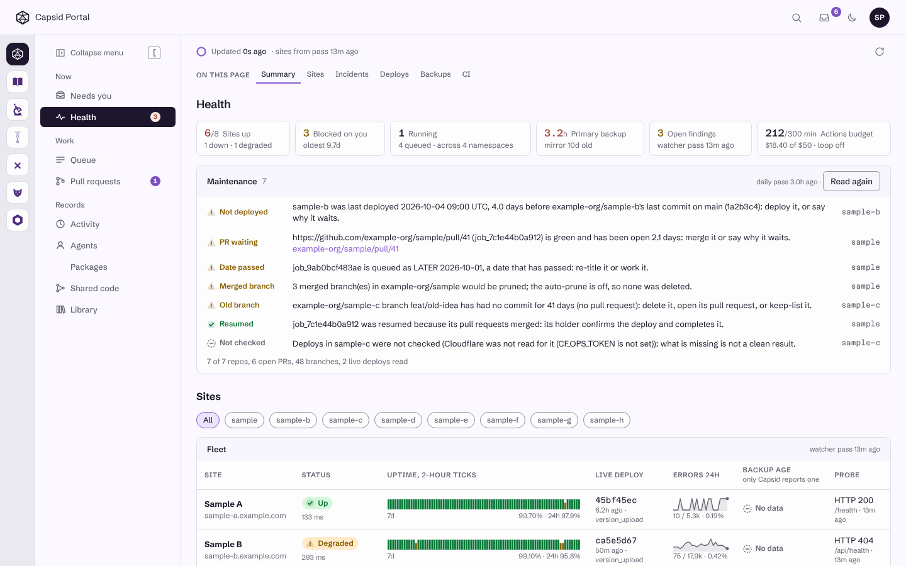
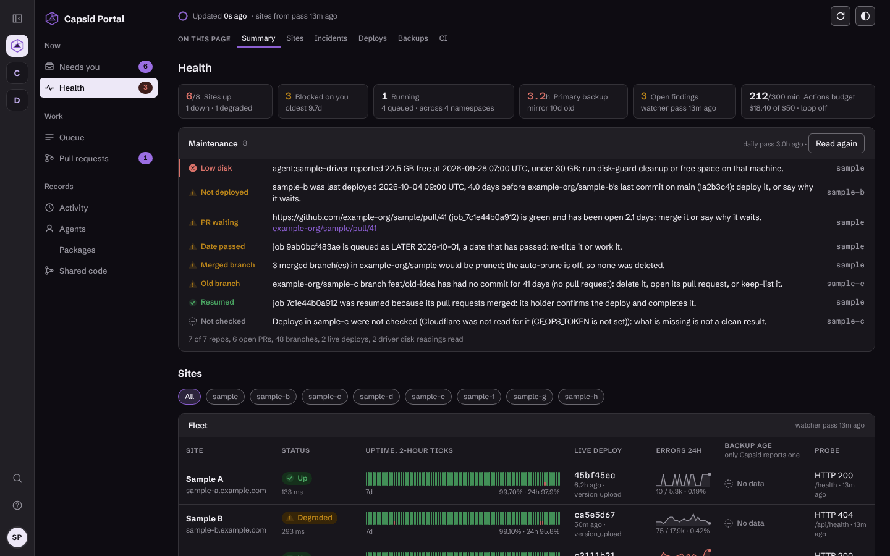
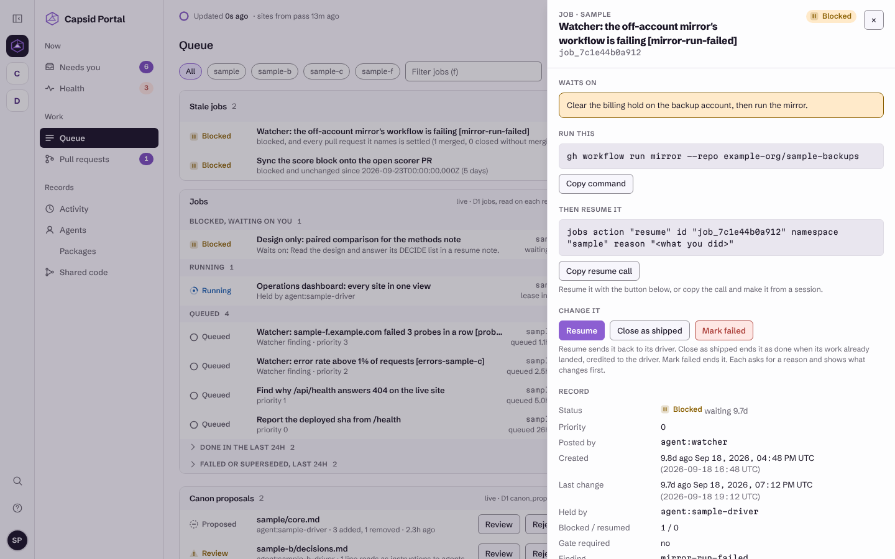

# Capsid

Capsid is one person's working system for running AI coding agents across his own projects. Dustin Edwards built it for himself and runs it every day. The code is public so you can read it, learn from it or copy parts of it under the MIT licence. It is not a product: there is no support, no hosted version and no promise that it will suit your setup.

In short, Capsid is a shared memory and a to-do list for AI agents. It keeps the decisions, rules and written tasks that every agent reads before it works. It gives each agent only the access its task needs. And it writes down what each agent says it did beside what GitHub shows really happened, so the two can be compared.

The picture is the [system explorer](https://capsid.dustinedwards.info), a public site that shows the systems Capsid serves, how they connect, and its daily numbers.

## Does it work?

Capsid publishes its own numbers once a day, with no login, at [mcp.dustinedwards.info/public/stats/v1.json](https://mcp.dustinedwards.info/public/stats/v1.json). [docs/public-data.md](docs/public-data.md) explains each field. As of 2026-10-14:

- **Tasks.** 407 tasks were finished in the last 30 days, 117 of them in the last 7. 151 tasks failed in the same 30 days. The middle task took 40 minutes.
- **Do the agents report their work correctly?** Over 90 days, Capsid checked an agent's own report against GitHub 1,085 times. The two agreed 97.7% of the time.
- **Did the work hold up?** Counting only what GitHub confirmed, 94.3% of the agents' pull requests were merged, and 95.5% passed their automated tests.
- **Sites.** Capsid watches 11 websites. Every half-hour check it made in the last 7 days found them up.
- **Memory.** The store holds 1,667 documents across 12 projects.

Each figure is a count or a rate across every agent and project, and a rate drawn from fewer than ten cases is left out.

## Words used here

- **Agent.** An AI coding session, such as Claude Code, working in one of the repositories.
- **Task.** One piece of work written down for an agent: a title and a full set of instructions. The code and older docs call it a job.
- **Project.** One area of the store, tied to one repository and its rules. The code calls it a namespace.
- **Owner.** Dustin, or a session acting for him. Only the owner may merge work or start a task's cloud session. The docs call this role the seat.
- **Routine.** A saved Claude Code setup on Dustin's account. When Capsid calls it, it starts a fresh cloud session.
- **MCP.** Model Context Protocol, the common way AI assistants call outside tools. Capsid is an MCP server.

## How a task gets done

1. Someone writes a task into the store. Capsid signs its text, so a change made later is caught.
2. The owner asks Capsid to start it. Capsid calls the routine, which opens a new Claude Code session in the cloud with the task's id ([docs/routines.md](docs/routines.md), `src/routine-fire.ts`).
3. The session reads the task, does the work on a branch and opens one pull request.
4. The session marks the task done by naming that pull request. The pull request is the record of the work ([docs/work-queue.md](docs/work-queue.md), `completeUnclaimed` in `src/jobs-seat.ts`).
5. Capsid reads the pull request from GitHub and stores what it finds beside what the session said. A task that reaches a push, a deploy, a secret, a database change or a merge stops and waits, with the exact command a person must run.

A pull request that changes what people see waits for the owner to look at its before-and-after screenshots, and Capsid alerts him with a preview.

Agents open pull requests and never merge them. The owner merges, or Capsid merges by itself where a signed policy allows it and every check passes ([docs/autonomy.md](docs/autonomy.md)).

## What is inside

- **Built on Cloudflare.** A Cloudflare Worker (a small program that runs on Cloudflare's servers), written in TypeScript. D1, Cloudflare's database, holds documents, versions, tasks, agents and the audit log. R2 storage holds backups.
- **Two logins.** Cloudflare Access signs in the owner. A GitHub App, with its own narrow permissions, reaches the repositories.
- **Two MCP servers.** Capsid has 14 tools for daily work. Capsid Admin has 8 more that change who may do what, for the owner only. That is 22 tools in all; `src/counts.ts` counts them from `TOOL_GRANTS` in `src/scope.ts`.
- **One key per agent.** Each agent has its own key and its own limits, and one function, `checkScope`, is the only place a permission is checked.
- **Nothing is lost.** Every overwrite or delete of a document keeps the old version and writes a line to the audit log.
- **Daily backups.** Every table is copied to R2 each morning and mirrored to a private repository, and a weekly run practises a restore ([docs/backups.md](docs/backups.md)).
- **Off by default.** An optional loop that proposes improvements to the code, and automatic merging, each have to be turned on.

The owner also has an admin app, the Capsid Portal, at portal.dustinedwards.info. It shows what needs the owner, the health of each site, the task list, open pull requests and the controls ([docs/portal.md](docs/portal.md)). The pictures below are drawn from sample data, not from the live site.

## What Capsid is not

- **Not for many users.** It admits its owner and any co-owners named in `CO_OWNER_EMAILS`. Agents are keys the owner makes, not other people.
- **Not a hosted service.** Each install is its own Worker on its own Cloudflare account. The one this repository runs is Dustin's.
- **Not a general agent framework.** It stores memory, issues keys, keeps the task list and passes GitHub requests through its GitHub App. It does not run AI models itself, except in the optional improvement loop.
- **Not a replacement for code review.** Agents never merge. Some paths, such as database changes, workflows, lockfiles and login code, always wait for a person. A merge to `master` here is a production deploy.
- **Not listed in any MCP directory.**

## If you want to run your own

You need a Cloudflare account and a GitHub App. [docs/bootstrap.md](docs/bootstrap.md) is written for that reader, and its section 10 ([a fresh install, step by step](docs/bootstrap.md#10-a-fresh-install-step-by-step)) lists the commands in order. Copy `wrangler.jsonc.example` to `wrangler.jsonc`, fill in your own ids, apply the migrations, set the secrets and run `npm run deploy`. Never commit `wrangler.jsonc`, `.dev.vars`, a key or real stored content.

## Documentation

### Setting up and connecting

- [docs/bootstrap.md](docs/bootstrap.md) a full install, making agent keys, the switches and the checks before a push
- [docs/auth.md](docs/auth.md) logins, agent keys, permissions, co-owners and every endpoint
- [docs/repo-access.md](docs/repo-access.md) how the GitHub App reads and writes repositories
- [docs/hooks.md](docs/hooks.md) what Claude Code sessions report back to Capsid
- [docs/telemetry.md](docs/telemetry.md) usage and cost per session and per task

### Tasks and agents

- [docs/work-queue.md](docs/work-queue.md) the life of a task, signing, waits and the evidence kept
- [docs/routines.md](docs/routines.md) how Capsid starts a cloud session for a task
- [docs/autonomy.md](docs/autonomy.md) automatic merging and what always waits for a person
- [docs/overnight.md](docs/overnight.md) the overnight run and the morning summary
- [docs/improve.md](docs/improve.md) the optional improvement loop and what stops it grading itself
- [docs/skills.md](docs/skills.md) sharing an idea that worked in one project with the others
- [docs/bench.md](docs/bench.md) the methods paper's paired comparison and how its runs are scored

### Watching the sites

- [docs/portal.md](docs/portal.md) the owner's admin app
- [docs/health-format.md](docs/health-format.md) the health answer every site gives
- [docs/live-checks.md](docs/live-checks.md) the checks run against each live site
- [docs/search-console.md](docs/search-console.md) reading each site's Google Search Console data, and the one-time setup
- [docs/bing-webmaster.md](docs/bing-webmaster.md) reading each site's Bing Webmaster Tools data, and the one-time setup
- [docs/public-data.md](docs/public-data.md) the public model and numbers
- [explorer/README.md](explorer/README.md) the system explorer at capsid.dustinedwards.info

### Data and recovery

- [docs/schema.md](docs/schema.md) the kinds of documents and the database tables
- [docs/consolidation.md](docs/consolidation.md) keeping the store tidy, and confirming before a delete
- [docs/backups.md](docs/backups.md) what the daily backup holds and how to restore it
- [docs/rollback.md](docs/rollback.md) going back to the previous version after a bad deploy

A source audit from 2026-09-16 is in [AUDIT-2026-09-16.md](AUDIT-2026-09-16.md). It is a snapshot, not current.

## Licence

MIT ([LICENSE](LICENSE)). Built and maintained by one person, Dustin Edwards, for his own use. No support is offered. The repository was named `capsid-mcp` until 2026-09-12.
