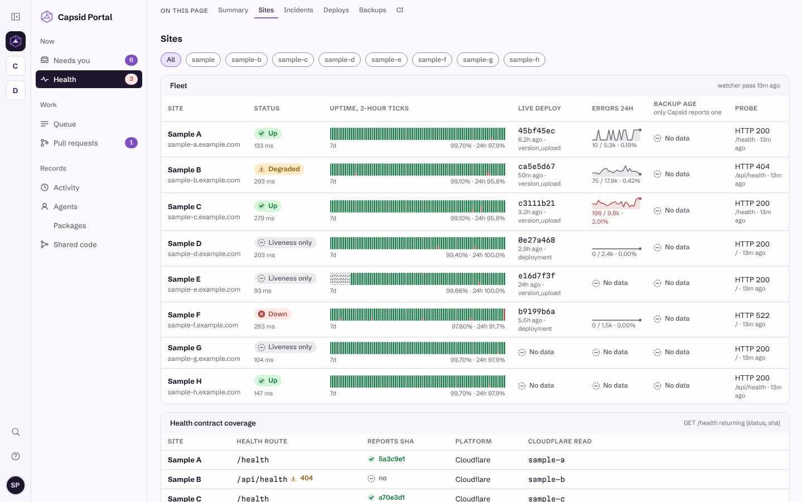
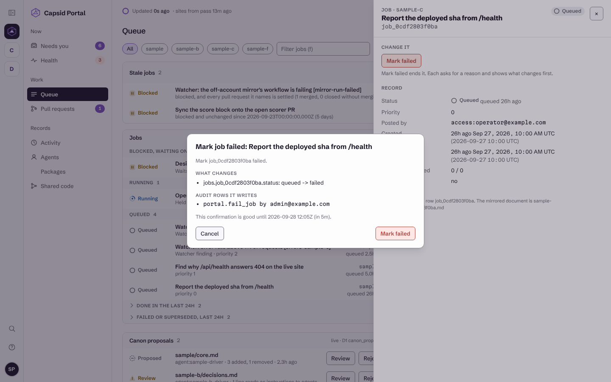
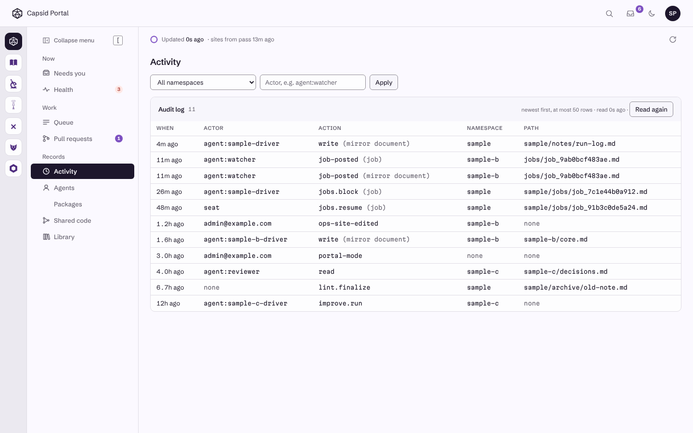
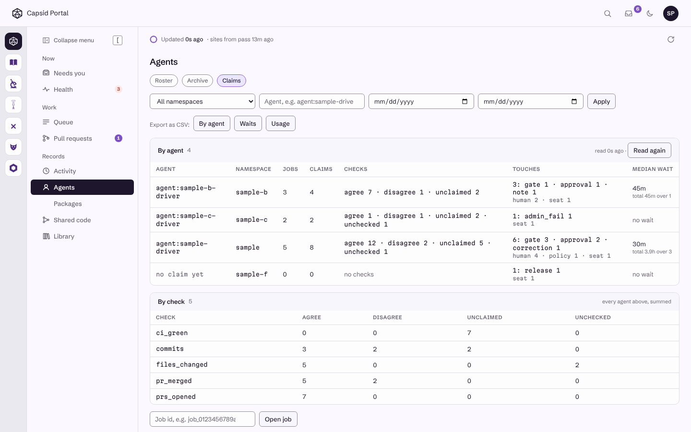
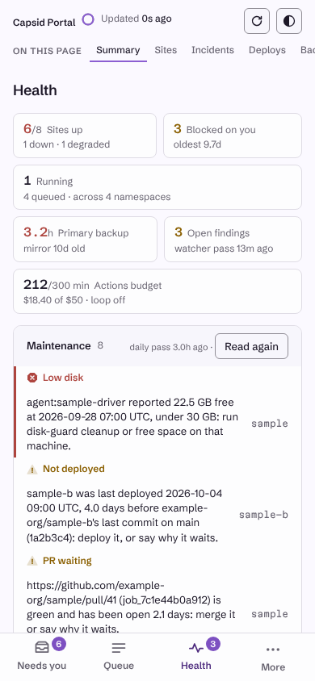
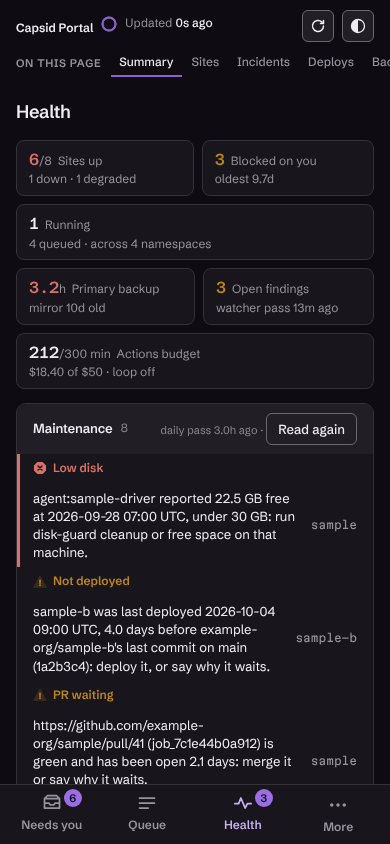

# Capsid

Capsid is a Cloudflare Worker that serves a knowledge base over MCP and coordinates AI coding agents working across a set of GitHub repositories. It has one owner (`ADMIN_EMAIL`), plus optional co-owners named in `CO_OWNER_EMAILS`. It is not a multi-user service.

## Why it exists

AI agents forget between sessions, and each repository has its own rules. Capsid keeps one shared store of decisions, rules and jobs that every agent reads, gives each agent only the access its job needs, and records what happened. The record keeps what an agent says it did apart from what GitHub confirms.

## How it is different

- **Scoped credentials.** Every caller is an agent with its own key and scopes, and one function, `checkScope`, is the only place a grant is checked.
- **A signed work queue.** Jobs carry a signed body, a lease and gates that stop at a push, a deploy, a secret or a merge until a person approves.
- **Claims and verified outcomes.** The driver's own statement is stored beside what GitHub shows, so the two can be compared.
- **Every overwrite and delete is kept.** Each one snapshots the old version and writes an audit row.
- **Off by default.** The improve loop, auto-merge and the nightly driver each need to be turned on.

## Stack

- Cloudflare Worker (TypeScript), stateless MCP through the Agents SDK, wrapped by [workers-oauth-provider](https://github.com/cloudflare/workers-oauth-provider) (OAuth 2.1 with PKCE)
- Cloudflare Access for SaaS (OIDC) for the MCP and Portal logins, and a separate GitHub App for repo access
- D1 for documents, versions, jobs, agents and the audit log, with FTS5 search
- R2 for backups and the loop's hidden test suites (two buckets), and two KV namespaces (`APP_KV` for caches, `OAUTH_KV` for OAuth state)

## Quick start

A fresh install needs a Cloudflare account and a GitHub App. [docs/bootstrap.md](docs/bootstrap.md) is written for that reader, and its section 11 ([a fresh install, step by step](docs/bootstrap.md#11-a-fresh-install-step-by-step)) lists the commands in order. Copy `wrangler.jsonc.example` to `wrangler.jsonc` (gitignored), fill in your ids, apply the migrations, set the secrets and run `npm run deploy`. Never commit `wrangler.jsonc`, `.dev.vars`, a key or real vault content.

## How agents connect

Capsid serves MCP over Streamable HTTP as two servers, each on two endpoints.

- **Capsid** (14 tools) is the working surface, on `/mcp` for the owner's OAuth login and `/ops/mcp` for agents and cron that hold a bearer key.
- **Capsid Admin** (8 tools) holds what changes who may do what or reads across every namespace. It is on `/mcp/admin` and `/ops/mcp/admin`, for the owner only, and its risky actions need a recent sign-in.
- **22 tools in all.** `src/counts.ts` derives the count from `TOOL_GRANTS` in `src/scope.ts`, and tests hold that table to the tools actually registered.
- **Clients.** Claude and ChatGPT identify themselves by a Client ID Metadata Document. Grok and Gemini use a tightened dynamic registration at `/register` that admits only allowlisted callbacks and grants nothing on its own (`src/dcr.ts`).
- **Job keys.** A session the seat starts on GitHub's runners trades its GitHub OIDC token at `/ops/runner-key` for a key bound to one job.

Detail: [docs/auth.md](docs/auth.md) (including the full endpoint list), [docs/bootstrap.md](docs/bootstrap.md), [docs/seat-start.md](docs/seat-start.md), [docs/routines.md](docs/routines.md).

## The work queue and claims

A job is a title and a signed body, and the body is the prompt a driver runs. A driver claims a job on a four-hour lease and works it. It opens a pull request and completes the job, and a job that reaches a push, a deploy, a secret, a live migration or a merge blocks with the exact command a person must run. Capsid stores the driver's claim and the evidence it can read from GitHub in separate tables (`job_claims`, `job_outcomes`, `job_evaluations`, `job_touches`). A field nobody reported is `NULL`, not `0`. Detail: [docs/work-queue.md](docs/work-queue.md), [docs/autonomy.md](docs/autonomy.md), [docs/schema.md](docs/schema.md), [docs/telemetry.md](docs/telemetry.md).

## The improve loop

An optional loop proposes one scoped change at a time to a roster of repositories. Each repository's own CI scores the change against a hidden holdout suite, and the loop opens a pull request only when no anchor metric regressed and the weighted score improved. It never merges, and it is off by default. Detail: [docs/improve.md](docs/improve.md).

## The Capsid Portal

The Portal is the owner's admin app, served at `/portal/` and on its own host. It shows what needs the owner, the health of each site, the job queue, agents, activity and the knowledge store, and it runs the controls for the automation switches. It signs in through the same Access app as the MCP login. Detail: [docs/portal.md](docs/portal.md).

## Security model

- **One enforcement point.** `checkScope` in `src/scope.ts` is the only grant check, and `TOOL_GRANTS` states what each tool requires. A tool with no entry requires write, so an omission fails closed.
- **Repo writes.** Every write to GitHub goes through `guardedWrite`, which checks the repo the call reaches and then writes an audit row.
- **Snapshots.** Every overwrite and delete of a document snapshots the prior version to `document_versions` and writes `audit_log`.
- **Co-owner.** A second person can hold the same access as the owner through the `CO_OWNER_EMAILS` secret. She cannot change `ADMIN_EMAIL` from inside Capsid.
- **Seat-started sessions.** The seat can start a Claude Code session on GitHub's runners for one queued job. It is off by default, runs on a public repo only, and has a network allowlist, a per-job key, no deploy rights and a canary test.
- **Limits.** [docs/auth.md](docs/auth.md) lists what Capsid cannot control, such as the owner's own shell.

Detail: [docs/auth.md](docs/auth.md), [docs/repo-access.md](docs/repo-access.md), [docs/seat-start.md](docs/seat-start.md), [docs/hooks.md](docs/hooks.md). A 2026-09-16 source audit is [AUDIT-2026-09-16.md](AUDIT-2026-09-16.md); it is a snapshot, not canon.

## Backups

A daily cron at 09:00 UTC dumps every D1 table to R2 as JSON, with a markdown mirror of every document. A private repo mirrors the dumps off-account, and a weekly job rehearses a restore. `wrangler d1 export` fails on the FTS5 table, so restore is per table. Detail: [docs/backups.md](docs/backups.md), [docs/rollback.md](docs/rollback.md).

## Documentation

- [docs/bootstrap.md](docs/bootstrap.md) minting agents, removing the operator key, the full setup, the switches and the checks to run before a push
- [docs/auth.md](docs/auth.md) the agent model, the five scope axes, the roles, the endpoint list, the co-owner, and the tool hints and list cache fields clients receive
- [docs/repo-access.md](docs/repo-access.md) how the GitHub App token flow works and which tools read and write repos
- [docs/routines.md](docs/routines.md) how Capsid starts a Claude Code cloud session for a queued job by firing its namespace's routine
- [docs/seat-start.md](docs/seat-start.md) how the seat starts a Claude Code session on GitHub's runners for a queued job, its guards and its canary
- [docs/telemetry.md](docs/telemetry.md) Claude Code's OpenTelemetry into Capsid: per-session usage, per-job cost on the outcome row, and the settings that turn it on
- [docs/work-queue.md](docs/work-queue.md) the job lifecycle, signing, leases, gates, evidence and agent records
- [docs/autonomy.md](docs/autonomy.md) auto-merge, pre-approved gate classes, the nightly driver and the watcher
- [docs/improve.md](docs/improve.md) the self-improvement loop: how it runs, and what stops it moving its own goalposts
- [docs/skills.md](docs/skills.md) how an idea abstracted from work that landed is offered to other projects
- [docs/portal.md](docs/portal.md) Capsid Portal: its views and data, what "no data" means, who gets in, its routes and controls, the Cloudflare token, and building it
- [docs/consolidation.md](docs/consolidation.md) the wiki maintenance loop, and the confirmation step on destructive writes
- [docs/backups.md](docs/backups.md) what the daily dump contains, and three restore paths in the order to try them
- [docs/rollback.md](docs/rollback.md) serving the previous Worker version when a deploy shipped a bad one
- [docs/schema.md](docs/schema.md) the knowledge model, the document types and the tables
- [docs/hooks.md](docs/hooks.md) Claude Code session hooks: what `/ops/hooks` keeps, who may post, and the settings for driver repos and Dustin's machine
- [docs/health-format.md](docs/health-format.md) the one health body every site answers with (status and sha), which the live `sha` check reads
- [docs/live-checks.md](docs/live-checks.md) the watcher's live checks: a site's deployed sha against its default branch, and the Web Analytics beacon and CSP on named pages
- [docs/public-data.md](docs/public-data.md) the public system model and stats documents served without auth
- [docs/overnight.md](docs/overnight.md) the overnight run: the plan per repo, the morning digest, and the scheduler switch with its Runs on choice
- [explorer/README.md](explorer/README.md) the system explorer at capsid.dustinedwards.info: pages built daily from the public documents, its checks, and its deploy

## What Capsid is not

- **Not multi-user.** It admits the owner, `ADMIN_EMAIL`, and any co-owners in `CO_OWNER_EMAILS`, for both logins. Agents are credentials an owner mints, not other users.
- **Not a hosted service.** Each install is its own Worker on its own Cloudflare account. The deployment this repo runs is for its author.
- **Not a general agent framework.** It stores memory, issues scoped keys, runs a job queue and relays GitHub operations through a GitHub App. It does not run models itself except in the optional loop's api mode.
- **Not a replacement for code review.** Drivers open pull requests and never merge them. Merges are made by the seat or, for namespaces a signed auto-merge policy allows, by the Worker when every check passes. A signed policy decides which namespaces may auto-merge ([docs/policy/auto-merge.md](docs/policy/auto-merge.md)). Paths such as migrations, workflows, lockfiles, auth and the policy sources always wait for the seat ([docs/autonomy.md](docs/autonomy.md)). A capsid merge is a production deploy.
- **The improve loop does not merge,** does not edit tests, CI or its own scoring, and does not touch a project that is not on the roster.
- **The Portal does not merge or mint.**
- **Not listed in an MCP directory.** It has not been submitted to any MCP directory or registry.

## Status and licence

MIT ([LICENSE](LICENSE)). Maintained by one person, Dustin Edwards. A push or merge to `master` deploys to production, docs included, so every merge to `master` is a deploy. The repository was named `capsid-mcp` until 2026-09-12.

Plans for what comes next are not kept here. They are in the Capsid store, namespace `capsid`, in the document `research/refactor-plan-2026-10-10.md` ("Capsid improvement list, 2026-10-11").
